> [!NOTE]
> 이 저장소(sojubada/TV-safari)는 [fdm96/Orbrisa](https://github.com/fdm96/Orbrisa)를 tvOS 16.6(TrollStore) 애플 TV에서 돌도록 빌드한 사본입니다. 바꾼 점: 배포 대상 15.6, 번들 ID `com.sojubada.orbrisa`, WebKit 로드 뒤에 `_privacyStance` 보정 설치. 이전 TV-safari 코드는 `backup/tv-safari-v4.22.0` 브랜치에 있습니다.

<div align="center">


# Orbrisa

**The web on the big screen.** A full web browser for Apple TV – with tabs, a real cursor,<br>and videos that play in the native Apple TV player.

[](#requirements)
[](#how-it-works)
[](https://github.com/fdm96/Orbrisa/releases)
[](https://github.com/fdm96/Orbrisa/actions/workflows/ci.yml)
[](https://github.com/fdm96/Orbrisa/releases)
[](https://ko-fi.com/T1M629LBVF)

[Features](#features) · [Screenshots](#screenshots) · [Concept](#from-concept-to-app) · [Roadmap](#roadmap--coming-next) · [Install](#install) · [Remote](#using-the-siri-remote) · [Build](#build-from-source) · [Deutsch](#deutsch)

</div>

---

> [!TIP]
> 🧪 **Beta 1.1.0 is out – Reader mode and RSS feeds!** Download `Orbrisa-1.1.0-Beta-1-unsigned.ipa` from the [pre-release](https://github.com/fdm96/Orbrisa/releases) and tell me what you think. See the [changelog](CHANGELOG.md) for everything that's new.

> [!IMPORTANT]
> Orbrisa uses private Apple APIs (tvOS has no public WebKit). It can never be on the App Store and is meant for sideloading onto your own Apple TV. Use at your own risk.

## Features

| | |
|---|---|
| 🌐 **Real browser** | WebKit (WKWebView) with tabs, session restore, favorites, history and a home page |
| 🗂️ **Tab strip** | Tabs with site logos right under the address bar, a large preview of the focused tab – optionally in each site's colour |
| 🖱️ **Cursor & scroll mode** | Move a cursor with the clickpad, or scroll the page – double-press to switch |
| 🔗 **Link navigation** | Jump from link to link with the ring, like a native tvOS app |
| ⌨️ **Direct keyboard** | Clicking the address bar or any text field opens the keyboard right away |
| 🫥 **Auto-hiding bar** | The top bar slides away while you scroll down and comes back when you scroll up |
| 🎬 **Video popup** | When a video starts: *Fullscreen*, *Choose video…* or *Stay on page* |
| 📺 **Native Apple TV player** | Fullscreen plays the page's real stream (HLS / MP4) in AVPlayer – with Siri Remote scrubbing |
| ⏭️ **Pre-roll skipping** | Adverts in front of a video are detected, fast-forwarded and skipped |
| 🧩 **VLC fallback** | Formats AVPlayer can't play (DASH, WebM, MKV …) open in a built-in VLC player |
| 🍪 **Cookie banners** | "Accept all" is clicked automatically (can be turned off) |
| 🌙 **Dark mode for websites** | Forces a dark look on pages without one – *Automatic* follows the Apple TV, or always light / dark |
| 💧 **Liquid Glass** | Glass look across the whole app, intensity adjustable with a slider or switched off |
| 🔠 **Font size slider** | Make page text smaller or larger from 50 % to 200 % |
| ⚙️ **Settings like tvOS** | Settings styled like the Apple TV Settings app, with real on/off switches |
| ✨ **What's New** | Shown once after each update, and any time under *Settings → Help* |
| 🧭 **Top Shelf** *(in development)* | Open tabs and favorites on the Apple TV home screen |
| 🌍 **English & German** | Follows the Apple TV language: German when it is set to German, English for every other language |
| 📖 **Usage guide** | Built-in guide with Siri Remote illustrations |

## Screenshots

<p align="center">
  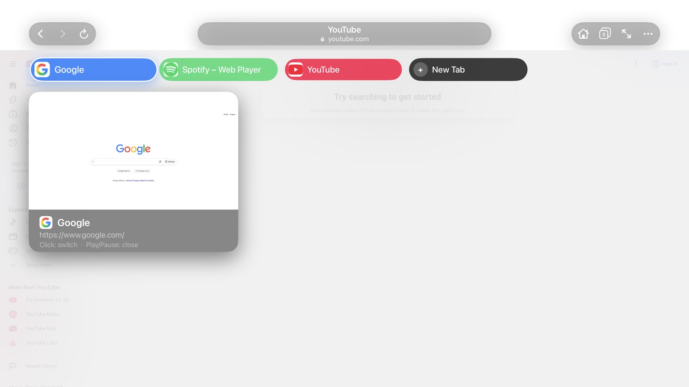
  <br><sub><b>Tab strip</b> – logos, site colours and a preview of the selected tab</sub>
</p>

<details>
<summary><b>📸 Show more screenshots (5)</b></summary>
<br>

| | |
|:---:|:---:|
| 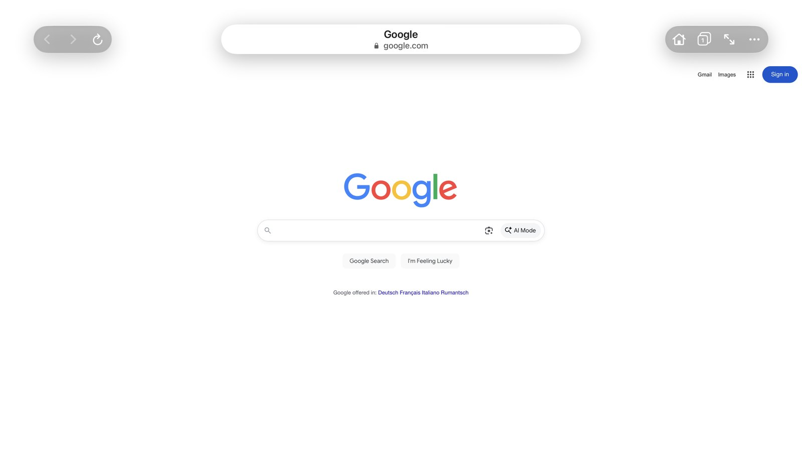 | 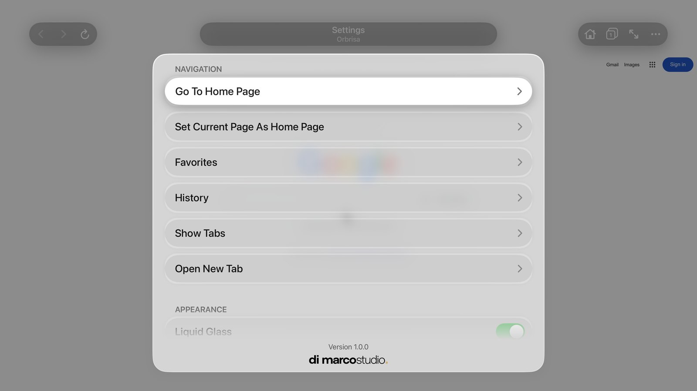 |
| **Browsing** – glass top bar | **Settings** – styled like tvOS |
| 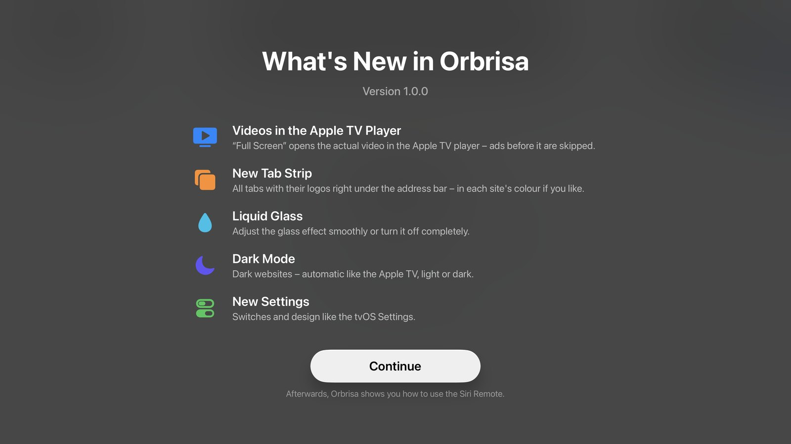 | 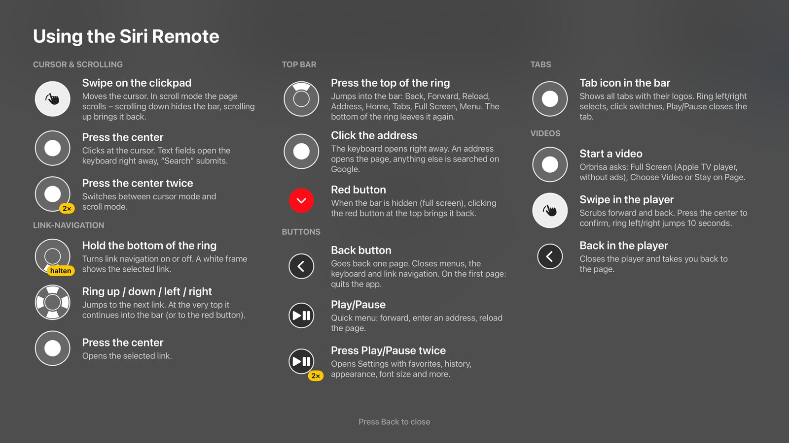 |
| **What's New** after every update | **Usage guide** for the Siri Remote |
| 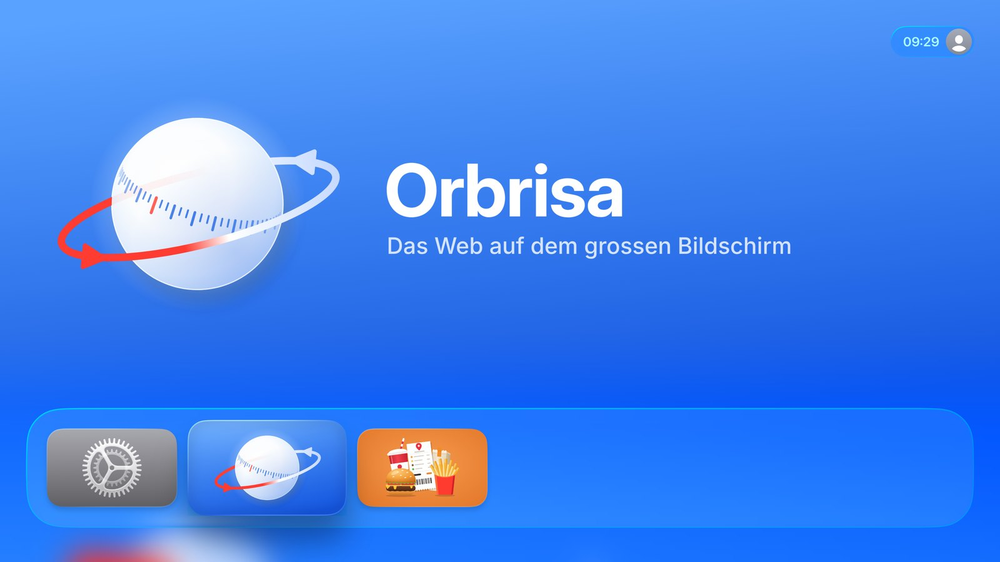 | |
| **Home screen** with Top Shelf | |

</details>

## From concept to app

Orbrisa started as a set of design concepts – drawn first, then built. Here is how the ideas turned into the real app.

<details>
<summary><b>🎨 Show concept vs. app (5)</b></summary>
<br>

| Concept | App |
|:---:|:---:|
| 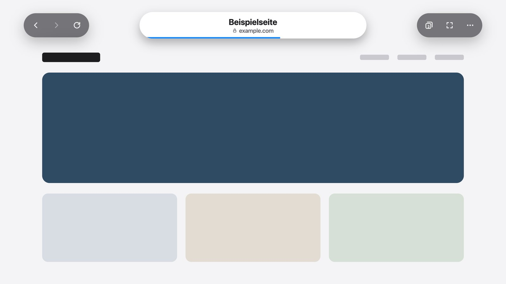 |  |
| **Top bar** – navigation, address and actions as glass capsules | |
| 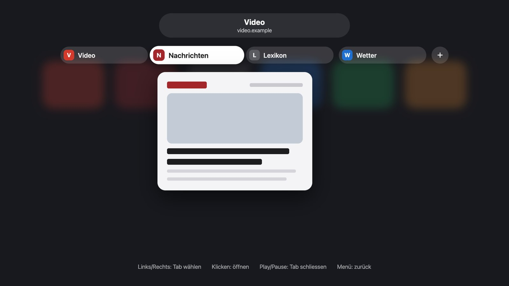 |  |
| **Tab strip** – tabs with logos and a large preview | |
| 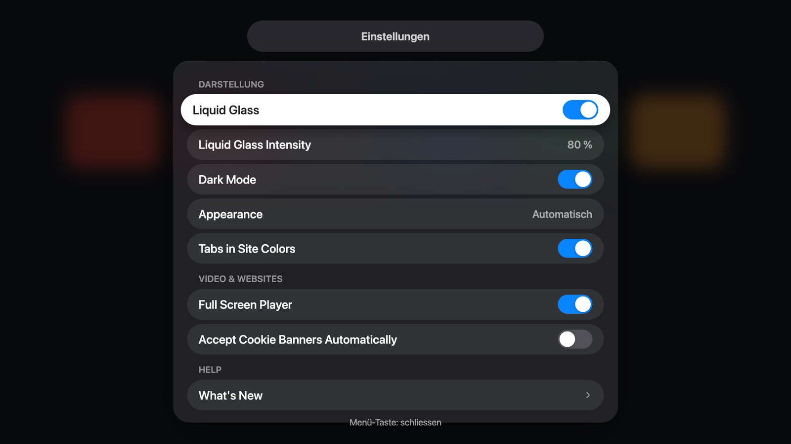 |  |
| **Settings** – styled like the tvOS Settings app | |
| 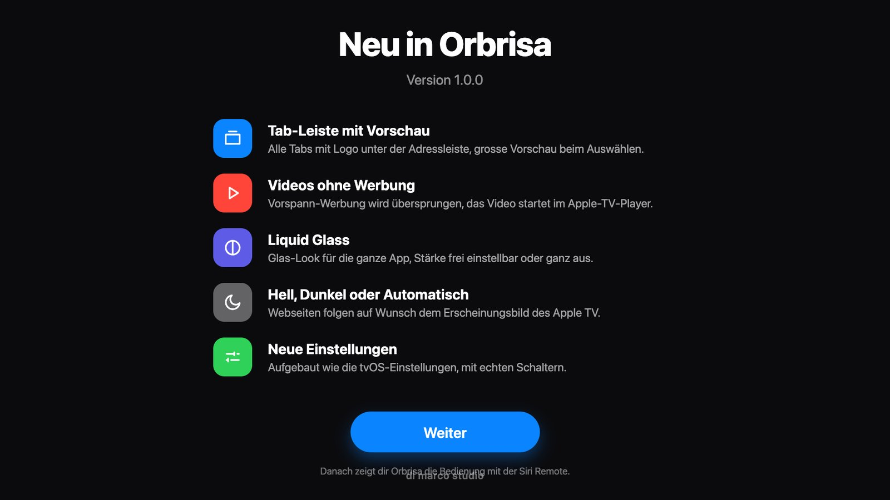 |  |
| **What's New** – shown after every update | |
| 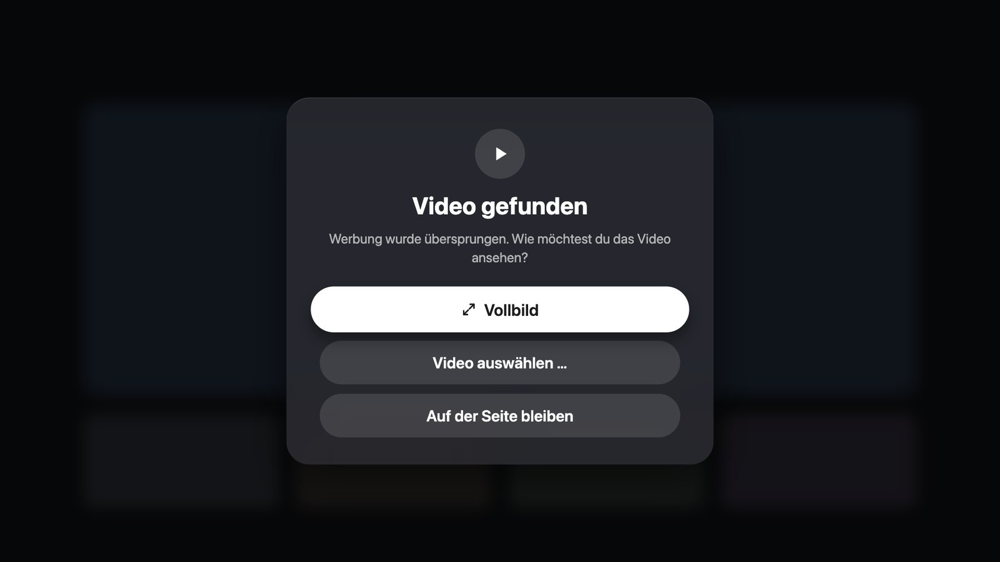 | |
| **Video popup** – Full Screen, Choose Video or Stay on Page | |

</details>

## Roadmap – coming next

These features are designed and planned for the next versions. The pictures are concepts – the final app may look a little different.

| | Feature | |
|:---:|---|---|
| 📖 | **Reader mode** 🧪 *in Beta 1.1.0* | Only the article – no ads, no menus. Large, calm text with your choice of size, background (light, sepia, grey, dark) and font. |
| 📰 | **RSS feeds** 🧪 *in Beta 1.1.0* | Subscribe to your favourite sites. Orbrisa spots a feed on a page and shows new articles in one overview. |
| 🖼️ | **Picture in picture** | Keep the video playing in a small window while you go on browsing. |
| 🔒 | **Private mode** | Tabs without history or cookies, locked with a 4-digit code. |

<details>
<summary><b>🔭 Show the concepts (6)</b></summary>
<br>

| | |
|:---:|:---:|
| 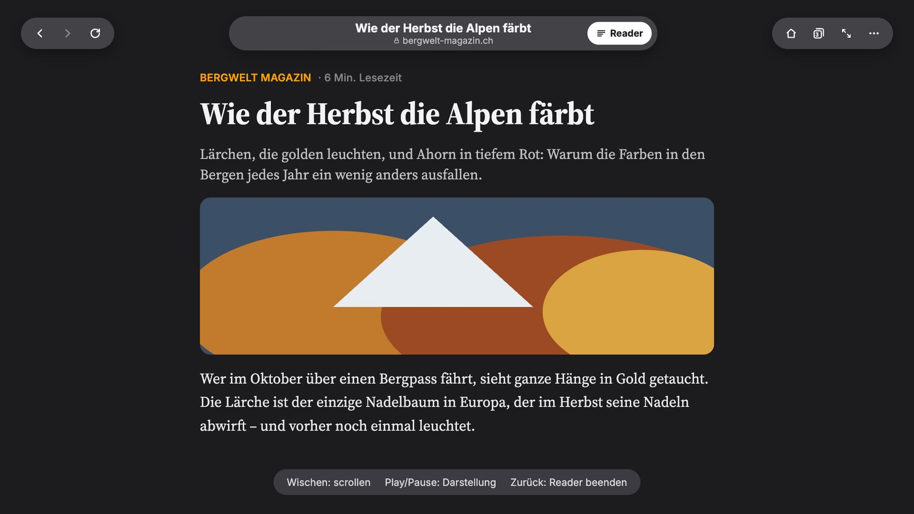 | 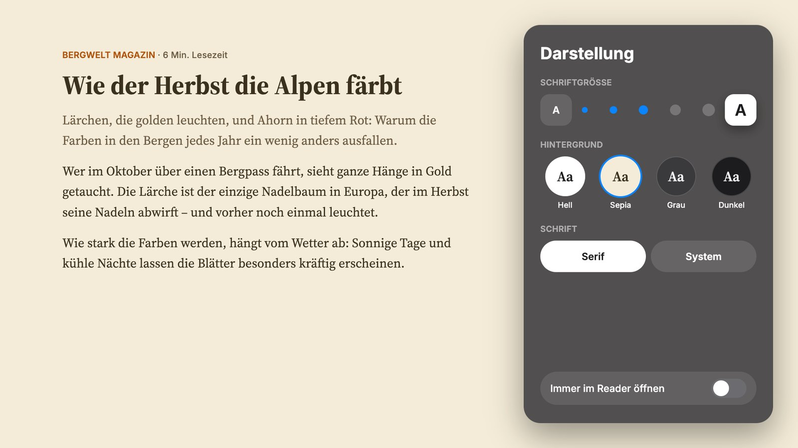 |
| **Reader mode** | **Reader** – size, background and font |
| 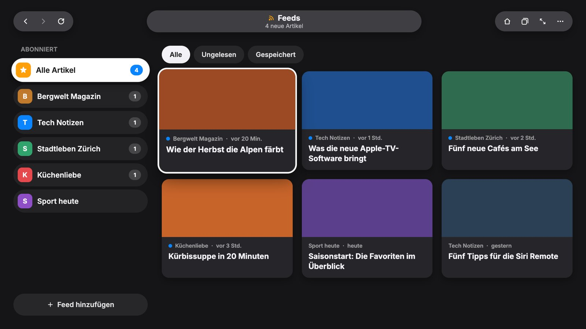 | 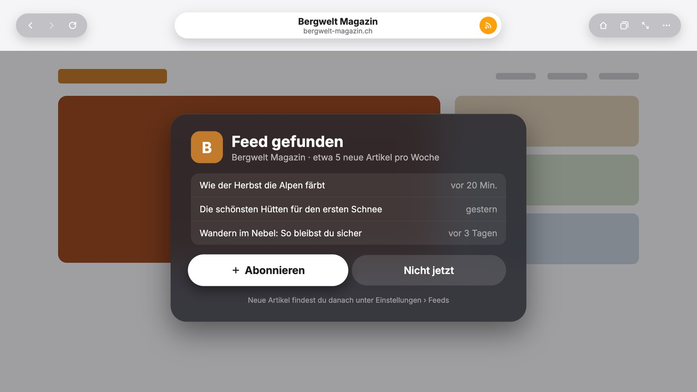 |
| **RSS** – all new articles at a glance | **RSS** – feed found on a page |
| 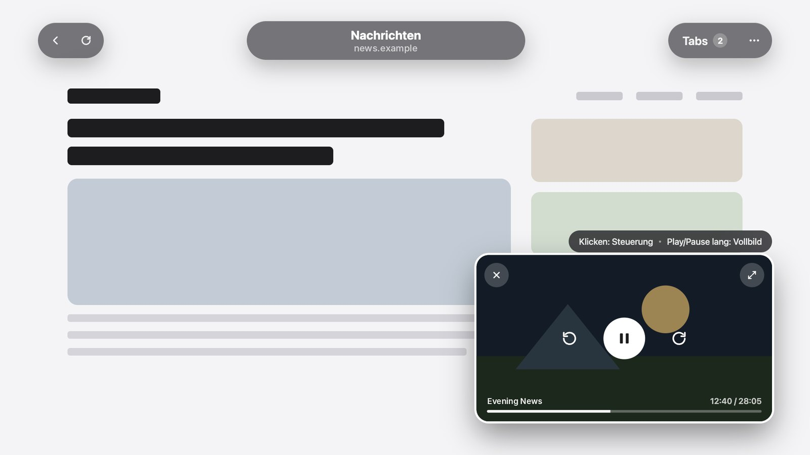 | 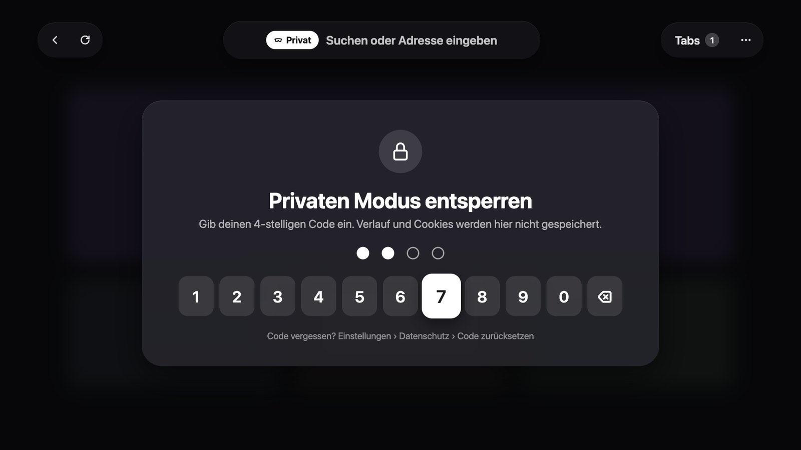 |
| **Picture in picture** – watch and browse | **Private mode** with code lock |

</details>

Got an idea for the roadmap? [Suggest it here](https://github.com/fdm96/Orbrisa/issues/new?template=feature_request.yml).

## Install

### Option A – unsigned IPA (sideload)

1. Download `Orbrisa-<version>-unsigned.ipa` from the [latest release](https://github.com/fdm96/Orbrisa/releases/latest) – or the newest beta from [all releases](https://github.com/fdm96/Orbrisa/releases).
2. Sign and install it on your Apple TV with a sideloading tool that supports tvOS (for example [Sideloadly](https://sideloadly.io)) and your Apple ID.
3. With a free Apple ID the app has to be re-installed every 7 days.

> [!NOTE]
> 🚧 **The Top Shelf is still in development** and may not show up yet.
> It needs an App Group. Some sideloading tools drop App Groups when re-signing – the browser still works, only the home-screen row stays empty.

### Option B – build with Xcode

See [Build from source](#build-from-source). A free Apple ID is enough.

## Requirements

- Apple TV HD or Apple TV 4K with **tvOS 17 or newer**
- For building: a Mac with **Xcode 26 or newer**

## Using the Siri Remote

| Button | Action |
|---|---|
| Swipe on the clickpad | Move the cursor – in scroll mode: scroll the page |
| Press the center | Click at the cursor (text fields open the keyboard) |
| Press the center twice | Switch between cursor mode and scroll mode |
| Hold the bottom of the ring | Link navigation on/off |
| Ring up / down / left / right | Next link (in link navigation) |
| Top of the ring | Into the toolbar: back, forward, reload, address, home, tabs, fullscreen, menu |
| Back | Previous page · closes menus and keyboard |
| Play/Pause | Quick menu: forward, enter address, reload |
| Play/Pause twice | Settings: favorites, history, appearance, font size and more |

In the Apple TV player the remote works exactly like in the TV app.

## Build from source

```bash
git clone https://github.com/fdm96/Orbrisa.git
cd Orbrisa
cp Configs/Local.xcconfig.example Configs/Local.xcconfig
```

Open `Configs/Local.xcconfig` and enter your **team ID** and a **bundle ID** of your own:

```xcconfig
DEVELOPMENT_TEAM = ABCDE12345
ORBRISA_BUNDLE_ID = com.yourname.orbrisa
```

Then open `Orbrisa.xcodeproj`, pick your Apple TV as the run destination and press **⌘R**.
Xcode downloads VLCKit (Swift Package) on the first build.
[How to pair an Apple TV with Xcode](https://developer.apple.com/documentation/xcode/running-your-app-on-a-device).

### Unsigned IPA from the command line

```bash
./scripts/make-ipa.sh            # → Orbrisa-<version>-unsigned.ipa in the project folder
./scripts/make-ipa.sh ~/Desktop  # → or into another folder
```

The script builds a Release version without signing and packs it as an IPA – sign and install it with a sideloading tool.

Pushing a tag like `v1.0.0` runs the same build on GitHub Actions and attaches the IPA to a release.

## How it works

```
Orbrisa/            the app (Objective-C, UIKit)
  BrowserWebView        WKWebView loaded at runtime + page scripts (stream capture, ad skipping)
  BrowserTabCoordinator tabs, snapshots, session, Top Shelf data
  BrowserVideoPlayback… / BrowserNativeVideoPlayer…  AVPlayer + VLC player
  BrowserPageActionCoordinator  clicks, video popup, fullscreen
OrbrisaTopShelf/    Top Shelf extension (open tabs + favorites)
Configs/            shared build settings, your Local.xcconfig
```

WebKit is not public on tvOS, so the app loads it at runtime and talks to it through the Objective-C runtime.
Page scripts report every video stream a page loads; the video player picks the real one and plays it natively.

## Credits

Orbrisa builds on [tvOSBrowser](https://github.com/jvanakker/tvOSBrowser) by **Jip van Akker**, which is itself a fork of the original [tvOSBrowser](https://github.com/steventroughtonsmith/tvOSBrowser) by **Steven Troughton-Smith**.
Developed with the help of [Claude](https://claude.ai) (Anthropic).
Video playback fallback by [VLCKit](https://code.videolan.org/videolan/VLCKit) (LGPL-2.1) – see [THIRD_PARTY_NOTICES.md](THIRD_PARTY_NOTICES.md).

## Feedback, bugs & ideas

Found a bug or have an idea? Please open an issue – it only takes a minute:

- 🐞 **[Report a bug](https://github.com/fdm96/Orbrisa/issues/new?template=bug_report.yml)** – what happened, on which website, your Apple TV model and tvOS version.
- 💡 **[Suggest an idea](https://github.com/fdm96/Orbrisa/issues/new?template=feature_request.yml)** – what you would like and why.

**A photo or log helps the most:** a quick photo of the TV with your phone is perfect – just drag it into the issue. If you build Orbrisa with Xcode, copy the console lines starting with `[MediaCapture]`, `[VideoChoice]` or `[AdDbg]` as well.

## Support Orbrisa

Orbrisa is free and made in my spare time. If you enjoy it, you can support its further development with a coffee on Ko-fi – thank you! ☕

[](https://ko-fi.com/T1M629LBVF)

## Disclaimer

This project is not affiliated with Apple. It is provided as is, without warranty or liability. Do not submit builds of this project to the App Store.
Websites, their content and their videos belong to their owners – Orbrisa only displays what the site delivers.

---

## Deutsch

**Orbrisa** ist ein Webbrowser für das Apple TV: Tabs, Cursor, Favoriten – und Videos laufen im echten Apple-TV-Player.

**Installieren**
- *Ohne Mac:* `Orbrisa-…-unsigned.ipa` aus den [Releases](https://github.com/fdm96/Orbrisa/releases) laden und mit einem Sideloading-Tool (z. B. Sideloadly) und deiner Apple-ID aufs Apple TV bringen. Mit kostenloser Apple-ID alle 7 Tage neu installieren.
- *IPA selbst bauen:* im Terminal im Orbrisa-Ordner `./scripts/make-ipa.sh` ausführen.
- *Mit Mac:* Projekt klonen, `Configs/Local.xcconfig.example` nach `Configs/Local.xcconfig` kopieren, Team-ID und eigene Bundle-ID eintragen, `Orbrisa.xcodeproj` öffnen, Apple TV wählen, **⌘R**.

**Bedienung** – Mitte zweimal drücken wechselt zwischen Cursor und Scrollen, Play/Pause öffnet das Schnellmenü, zweimal Play/Pause die Einstellungen. Die ganze Anleitung mit Bildern der Fernbedienung ist in der App unter *Einstellungen → Hilfe → Bedienungsanleitung*.

**Videos** – Startet ein Video, fragt Orbrisa: *Vollbild* (echter Stream im Apple-TV-Player, Werbung wird übersprungen), *Video auswählen …* oder *Auf der Seite bleiben*.

**Beta 1.1.0** 🧪 – Neu zum Ausprobieren: **Reader-Modus** (nur der Artikel, mit Schriftgrösse, Hintergrund Hell/Sepia/Grau/Dunkel, Schriftart und „Immer im Reader öffnen“) und **RSS-Feeds** (RSS-Knopf neben der Adressleiste, Feed-Übersicht mit ungelesenen Artikeln). Die IPA `Orbrisa-1.1.0-Beta-1-unsigned.ipa` gibt es unter [Releases](https://github.com/fdm96/Orbrisa/releases).

**Geplant** – Bild-in-Bild (Video läuft weiter, während du surfst) und ein privater Modus mit Code-Sperre. Die Entwürfe findest du oben unter *Roadmap*.

**Fehler oder Ideen?** – Bitte ein [Issue erstellen](https://github.com/fdm96/Orbrisa/issues/new/choose). Ein Foto vom Fernseher (einfach mit dem Handy) oder ein Log aus Xcode hilft am meisten.

**Unterstützen** – Orbrisa ist kostenlos. Wenn dir die App gefällt, kannst du die Weiterentwicklung mit einem Kaffee auf [Ko-fi](https://ko-fi.com/T1M629LBVF) unterstützen – danke! ☕

---

<div align="center">

<a href="https://github.com/fdm96">
  <picture>
    <source media="(prefers-color-scheme: dark)" srcset="docs/dimarcostudio-dark.png">
    
  </picture>
</a>

<sub>Made with care in Switzerland</sub>

</div>
