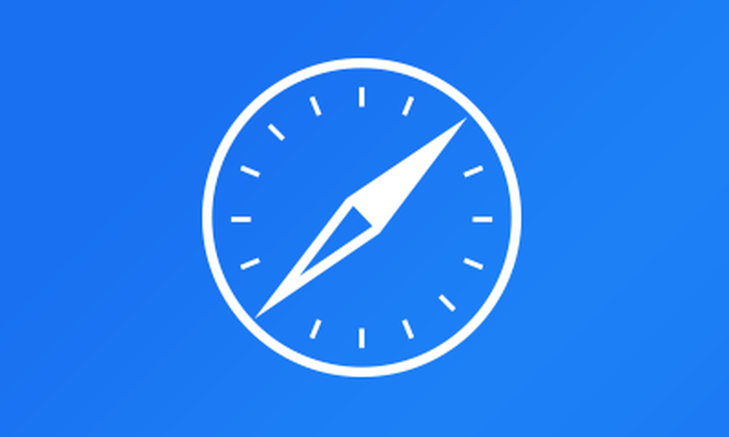

# TV-safari — a web browser for Apple TV on tvOS 16

A full WebKit browser for Apple TV, built to run on **tvOS 15.6 – 16.x** and installed with **TrollStore**.
Tabs, a real cursor, Korean and English typing from a Bluetooth keyboard, ad blocking, and a set of fixes that keep pages loading on tvOS 16.

[Download](#install) · [What's in it](#features) · [Where the code comes from](#where-the-code-comes-from) · [Remote](#using-the-siri-remote) · [Keyboard](#typing-with-a-bluetooth-keyboard) · [Fixes for tvOS 16](#fixes-for-tvos-16) · [Build](#building) · [Sources](#references)

---

> [!IMPORTANT]
> tvOS has no public WebKit, so this browser uses private Apple APIs. It can never be on the App Store and is meant for sideloading onto **your own** Apple TV. Use at your own risk.

## Where the code comes from

This repository has had two lives, and both are credited here.

| | Project | What it contributed |
|---|---|---|
| 1 | [steventroughtonsmith/tvOSBrowser](https://github.com/steventroughtonsmith/tvOSBrowser) — Steven Troughton-Smith, 2015 | The original idea and code: a WebKit browser for tvOS with a cursor driven by the Siri Remote |
| 2 | [jvanakker/tvOSBrowser](https://github.com/jvanakker/tvOSBrowser) — Jip van Akker | The maintained fork this repository started from (October 2026), including upstream's `_privacyStance` fix for tvOS 16 ([issue #54](https://github.com/jvanakker/tvOSBrowser/issues/54), [PR #58](https://github.com/jvanakker/tvOSBrowser/pull/58)) |
| 3 | **TV-safari v1 – v4.22** — this repository | About eighty commits of our own on top of (2): typing, remote control, stability on tvOS 16, ad blocking, diagnostics. Kept unchanged on the branch [`backup/tv-safari-v4.22.0`](https://github.com/sojubada/TV-safari/tree/backup/tv-safari-v4.22.0) |
| 4 | [fdm96/Orbrisa](https://github.com/fdm96/Orbrisa) — commit `e6a6db1`, 5 Nov 2026 | Also derived from (2); a far more complete browser for tvOS 17+: tab strip, the native Apple TV player, VLCKit, Reader, RSS feeds, link navigation, Top Shelf, Liquid Glass |
| 5 | **This build** | Orbrisa (4) as the base, backported to tvOS 16, with the work from (3) carried over into it |

The app is named **tvOS Browser** and uses the original blue compass icon from tvOSBrowser (1), as TV-safari did. Its bundle ID (`com.sojubada.orbrisa`) is its own, so it sits next to any earlier TV-safari build rather than replacing it. Copyright notices in the source files from (1), (2) and (4) are kept.

## Features

**From Orbrisa**

| | |
|---|---|
| 🌐 **Real browser** | WebKit (WKWebView) with tabs, session restore, favorites, history and a home page |
| 🗂️ **Tab strip** | Tabs with site logos under the address bar and a large preview of the focused tab |
| 🖱️ **Cursor & scroll mode** | Move a cursor with the clickpad, or scroll the page; press the center twice to switch |
| 🔗 **Link navigation** | Jump from link to link with the ring, like a native tvOS app |
| 🎬 **Native player** | Videos play in the Apple TV player; VLCKit plays the formats the system player can't |
| 📖 **Reader & feeds** | A clean reading view for articles, and RSS/Atom feeds |
| 🍪 **Cookie banners** | Accepted automatically (optional) |
| 🫥 **Auto-hiding bar** | The top bar slides away while scrolling down and comes back when scrolling up |

**Added here (from TV-safari)**

| | |
|---|---|
| ⌨️ **Bluetooth keyboard typing** | Type straight into page fields and the address bar, without the full-screen keyboard |
| 🇰🇷 **Korean input** | 2-set (Dubeolsik) Hangul composed in the app, with the syllable in progress underlined |
| 🕹️ **TV-safari remote control** | Page-by-page scrolling on the ring, hold to keep scrolling, back/forward on left/right, edge scrolling, tap to click, magnetic top bar |
| ⭐ **Favorites star** | A star between Home and Tabs: add or remove the current page in one press, and the favorites list |
| 🛡️ **Ad & tracker blocking** | 25,000 hosts from EasyList and EasyPrivacy, compiled once as a WebKit content rule list |
| 🩺 **Stability on tvOS 16** | Bounded waits, recovery when the page process dies, a stuck-load watchdog, cache and disk care — see [below](#fixes-for-tvos-16) |
| 📝 **Diagnostic log** | Loads, failures, crashes with call stacks, memory and disk, readable inside the browser |

## Install

1. Download the newest `Orbrisa-<version>-tvOS15.6-unsigned.ipa` from [Releases](https://github.com/sojubada/TV-safari/releases).
2. Install it with **TrollStore** on an Apple TV running tvOS 15.6 – 16.x (tested on tvOS 16.6, Apple TV 4K).

The IPA is unsigned and is not modified for any jailbreak. The app stays inside its own sandbox: it adds no entitlements and writes nothing outside its own container.

## Using the Siri Remote

| Button | Action |
|---|---|
| Swipe on the clickpad | Move the cursor (scroll mode: scroll the page). The cursor fades after 3 s idle |
| Light tap on the clickpad | Click (Tap to Click, can be turned off) |
| Press the center | Click at the cursor |
| Press the center twice | Switch between cursor mode and scroll mode |
| Hold the center | Link navigation on/off |
| Ring up / down | Scroll one screen · hold: keep scrolling |
| Ring left / right | Previous / next page |
| Cursor at the top / bottom edge | The page scrolls by itself |
| Ring up with the cursor by the bar, or at the top of the page · slide the cursor into the bar | Into the top bar: back, forward, reload, address, home, ⭐ favorites, tabs, full screen, menu |
| Ring down, or a firm swipe down | Out of the top bar |
| Back | Previous page · closes menus and typing |
| Play/Pause · twice | Quick menu · Settings |

In link navigation the ring moves between links and the center opens one. In the Apple TV player the remote works as it does in the TV app.

In Orbrisa, holding the bottom of the ring turned link navigation on and off. That gesture now scrolls, as it did in TV-safari, so link navigation moved to holding the center.

## Typing with a Bluetooth keyboard

Click a text field or the address bar with a keyboard paired, and a slim typing bar appears; letters go straight into the page. Without a keyboard, or if a paired keyboard never sends a key, the Apple TV keyboard opens as before.

| Key | Action |
|---|---|
| 한/영 (Lang1), Caps Lock, or Control+Space | Switch between Korean and English |
| Option + key (Korean mode) | Type the Latin character anyway |
| Return | Send the field (Enter, then `requestSubmit()`); in the address bar, open the address or search |
| Esc, or Back on the remote | Stop typing |
| Backspace | Remove one jamo from the syllable in progress, otherwise one character |

Keys are read through the Game Controller framework (`GCKeyboard`) and through UIKit key presses. Each key is used once, and Return never also clicks the page. [docs/hardware-keyboard-input.md](docs/hardware-keyboard-input.md) describes the design.

## Fixes for tvOS 16

Orbrisa targets tvOS 17 and newer. Running it on tvOS 16 needed the backport below, and the fixes TV-safari had already found on this system were carried over. The commit messages record how each problem was found.

| Problem on tvOS 16 | Fix |
|---|---|
| `registerForTraitChanges:` does not exist before tvOS 17, so the app quit at launch | Guarded with `@available`, with `traitCollectionDidChange:` as the tvOS 16 path |
| AVFoundation asks WebKit's metrics object for `_privacyStance`, which this WebKit lacks; pages with video killed the page process | The method is added at run time *after* WebKit is loaded (upstream's `+load` runs too early when WebKit is reached through `dlopen`); pages are kept off AVFoundation by default, with a switch to turn media back on |
| The user agent claimed Safari 17, so sites sent code this engine (Safari 16.6) does not have | The agent says Safari 16.6 |
| A dead page process left the first screen showing and nothing below it | Reload once; twice on the same page, ask the site for its phone page from then on; a third time, offer the choice |
| A synchronous answer from WebKit was waited for with no limit, so a busy page froze the app | Waits are bounded (2 s for scripts, 5 s for cookies) |
| A page that never started held the web view, and every address after it queued behind it | A new address cancels the old load; after 30 s with no start, the web view is replaced, once per address |
| WebKit's caches grew until loads failed with "No space left on device" | URL cache capped at 8/48 MB; WebKit's caches (not cookies or logins) are trimmed below 1.5 GB free |
| Memory warnings | Background tabs are released and reload when opened |

## Settings added in this build

| Section | Setting | Default |
|---|---|---|
| Remote Control | Ring up/down scrolls the page · Scroll at the screen edge · Tap to click · Scroll boxes inside pages | On |
| Video Playback | Play media inside pages (Orbrisa's original media setup) | Off |
| Compatibility | Block ads and trackers · Phone page for sites that keep crashing · Sites opened as phone pages | On |
| Maintenance | Diagnostic log | — |

## Building

There is no local Xcode in this workflow; every build runs on GitHub Actions.

**Actions → Build unsigned tvOS IPA → Run workflow**

| Input | Default | |
|---|---|---|
| `deployment_target` | `15.6` | Lowest tvOS the app runs on |
| `publish_release` | off | Off: build and keep the IPA as a workflow artifact. On: also publish a Release |
| `release_tag` | `build-<run>` | Tag of the Release |

The workflow fails instead of publishing if the build uses an API newer than the deployment target without a guard, or if any binary in the app needs a tvOS newer than 16.6.

## References

Sources consulted and used in this work:

- [steventroughtonsmith/tvOSBrowser](https://github.com/steventroughtonsmith/tvOSBrowser) — the original tvOS browser
- [jvanakker/tvOSBrowser](https://github.com/jvanakker/tvOSBrowser) — the fork this repository began from; [issue #54](https://github.com/jvanakker/tvOSBrowser/issues/54) and [PR #58](https://github.com/jvanakker/tvOSBrowser/pull/58) on the tvOS 16 `_privacyStance` crash
- [fdm96/Orbrisa](https://github.com/fdm96/Orbrisa) — the browser this build is based on
- [microsoft/playwright issue #10892](https://github.com/microsoft/playwright/issues/10892) — the same `_privacyStance` call from AVFoundation taking down WebKit's content process
- [navilera/NavilIMEforMac](https://github.com/navilera/NavilIMEforMac) — reference for 2-set Hangul composition and the underlined syllable in progress
- [EasyList and EasyPrivacy](https://easylist.to) — the hosts in the ad and tracker blocklist
- [VLCKit](https://code.videolan.org/videolan/VLCKit) — playback of formats the system player can't handle (LGPL-2.1-or-later)

## License

Neither tvOSBrowser nor Orbrisa includes a license file. Code without a license stays under its authors' copyright, so this repository and its builds are kept for **personal use** on your own device. See [THIRD_PARTY_NOTICES.md](THIRD_PARTY_NOTICES.md) for VLCKit and the blocklist. If you are one of the authors above and want something changed or removed, please open an issue.
